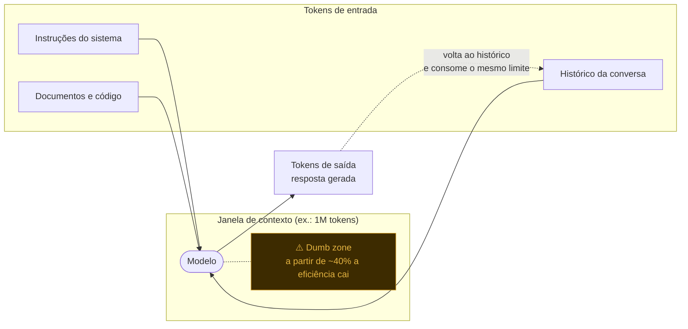

Essa é uma das perguntas que mais recebo no dia a dia, e assim como escolher seu **Pokemon inicial** essa é uma escolha muito importante na hora de realizar uma tarefa.

Neste artigo vou falar um pouco de quais aspectos considerar e sair um pouco do clássico "depende" para uma decisão mais baseada em dados, benchmarks e experiência prática.

> Então bora lá!

## Níveis de complexidade das tarefas

- **Simples:** ajustes pontuais, documentação e testes básicos
  - Priorizando modelos mais rápidos e econômicos
- **Intermediária:** implementação de features, refatorações e execução de skills
  - Modelos que priorizem o equilíbrio entre qualidade, velocidade e custo
- **Complexa:** Decisões arquiteturais, debugging avançado e problemas que exigem maior raciocínio
  - Priorizar modelos com uma janela de contexto maior e raciocínio estendido

| Complexidade | Anthropic | OpenAI | DeepSeek | Outros modelos de mercado que podem estar aqui | Esforço sugerido |
| --- | --- | --- | --- | --- | --- |
| 🟢 Simples | Haiku 5.5 | GPT-6 Luna | V4.1 Flash | Qwen (versões menores), GLM Flash | Low a Medium |
| 🟡 Intermediária | Sonnet 5.5 | GPT-6.1 Sol | V4 Pro | Kimi, GLM, MiniMax | Medium a High |
| 🔴 Complexa | Opus 5.5 (Fable 5.1 se faltar) | GPT-6 Astra | V4 Pro com raciocínio ligado* | Qwen Max, Kimi com thinking | High a Max |

Temos uma variedade gigante de modelos hoje (assim como pokemons...), acima temos uma tabela com sugestões de quais modelos podem fazer mais sentido para cada nível de complexidade, mas é importante testar e validar o que melhor se encaixa para sua necessidade.

> Já vou dar um spoiler aqui: utilizo o GPT-5.6 Luna para a maior parte das minhas tarefas, claro que colocando o raciocínio estendido quando necessário, mas para tarefas simples ele é rápido e barato, e para tarefas complexas ele consegue entregar um bom resultado.

## Quais são os principais fatores a considerar ao escolher um modelo de LLM para sua tarefa?

- Agentic (Capacidade agêntica)
- Reasoning (Capacidade de raciocínio)
- Context Window (Janela de contexto)
- Latência
- Custo por token

### Agentic (Capacidade agêntica)

Capacidade de executar tarefas de forma autônoma, utilizar ferramentas, navegar por repositórios de código e resolver problemas em múltiplas etapas. Isso é um dos principais pontos que virou o jogo e fez a diferença entre os modelos de hoje e os de 2023, lá com o ChatGPT 3.5, tínhamos modelos que não conseguiam executar tarefas de forma autônoma.

Hoje os modelos de fronteira focam principalmente em **capacidade agêntica**, e isso é um ponto que deve ser considerado na hora de escolher o modelo certo para sua tarefa no claude code, codex ou qualquer ferramenta de harness que você utilize.

### Reasoning (Capacidade de raciocínio)

| Capacidade de raciocínio | Descrição |
| --- | --- |
|  | **Raciocínio reduzido**: Prioriza respostas rápidas e menor consumo de tokens. Indicado para tarefas previsíveis, como ajustes simples, documentação e geração de código repetitivo. |
|  | **Raciocínio moderado**: Equilibra profundidade, velocidade e custo. É um bom ponto de partida para implementação de features, testes, refatoração e tarefas com skills. |
|  | **Raciocínio aprofundado**: Adequado para problemas que exigem investigação, análise de múltiplos componentes e avaliação de trade-offs, como bugs difíceis, concorrência e performance. |
|   | **Raciocínio intensivo**: Destinado a problemas especialmente complexos, com muitas dependências, hipóteses e restrições. Pode aumentar significativamente o custo e o tempo de processamento. |

### Context Window (Janela de contexto)

A janela de contexto é o número máximo de tokens que o modelo consegue considerar durante a execução de uma tarefa. Esse limite é compartilhado entre os tokens de entrada — como instruções, histórico e documentos — e os tokens de saída gerados pelo modelo. Modelos com janelas maiores podem lidar com tarefas mais complexas, desde que o conteúdo seja realmente relevante.



Entrada e saída dividem o mesmo orçamento de tokens, e a resposta gerada volta para o histórico, ocupando ainda mais espaço no próximo turno.

> Disclaimer: Não é porque temos 1M de tokens de contexto que o modelo vai conseguir usar tudo isso de forma eficiente, temos uma dumb zone onde, a partir de 40% da janela de contexto o modelo começa a perder eficiência, então é importante sempre testar e validar.

### Latência

A latência é o tempo que o modelo leva para gerar uma resposta. Modelos com menor latência são ideais para tarefas que exigem respostas rápidas, como interações com clientes em SaaS, chatbots e assistentes virtuais.

Enquanto modelos com maior latência podem ser mais adequados para tarefas complexas que requerem raciocínio mais profundo onde o mais importante é a qualidade da resposta, como decisões arquiteturais e debugging avançado.

### Custo por token

Esse aqui é o que pesa no final do mês para quem utiliza modelos pagos, sempre analise esses números mágicos:

- Input tokens: tokens que você envia para o modelo
- Output tokens: tokens que o modelo gera como resposta

**Exemplo**: Rodando um `/usage` no claude

``` bash
Settings  Status   Config   Usage   Stats

Session

Total cost:            $0.4339
Total duration (API):  59s
Total duration (wall): 31m 31s
Total code changes:    25 lines added, 3 lines removed
Usage by model:
    claude-haiku-4-5:  929 input, 17 output, 0 cache read, 0 cache write ($0.0010)
    claude-sonnet-5-5:  732 input, 5.6k output, 1.0m cache read, 42.1k cache write ($0.4329)
Prompt cache (main):   15 requests · 95% of input tokens from cache · no misses · warm (1h TTL, last activity 13m 15s ago)
```

Aqui podemos ver que o modelo Sonnet 5.5 gerou 5.6k tokens de saída, e o custo por token foi de $0.4329, enquanto o modelo Haiku 4-5 gerou apenas 17 tokens de saída com um custo de $0.0010.

Exemplo de custo de input e output por modelo:


## Uma estratégia interessante: Escalonamento de modelos

Em vez de utilizar sempre o modelo mais poderoso, podemos adotar uma estratégia de Model Routing:

1. Começar com um modelo mais equilibrado, como Sonnet.
2. Avaliar a qualidade da resposta e capacidade de execução.
3. Escalar para um modelo mais poderoso quando houver dificuldade de raciocínio, baixa qualidade ou complexidade maior.
4. Retornar para modelos menores durante tarefas de implementação mais previsíveis, como ajustes simples, documentação e geração de código repetitivo.

Isso também se aplica ao Loop Engineering, no qual diferentes agentes podem utilizar modelos diferentes dependendo da complexidade da tarefa que estão executando.


## Benchmarks

Quem acompanha o [Podcast AI Sob Controle da Alura](https://open.spotify.com/show/5xLCMHJ6eGWzdu8JaIDkuP?si=f9ee50f4daed45b1) sabe que temos diversos benchmarks para analisar os modelos que saem toda semana, até é complicado acompanhar 😅. Essas análises são muito úteis para termos uma perspectiva de como os modelos evoluem e foi deles que trouxe as principais métricas acima.

Aqui tem um exemplo do mês de outubro de 2026 no [BenchLM](https://benchlm.ai/) com os principais modelos do mercado, e como eles se comportam em relação a raciocínio, latência e custo por token.


Na maioria dos provedores, mais esforço de raciocínio gera mais tokens de saída, o que aumenta custo e latência. Como dá para ver na imagem acima, o modelo GPT-6 Astra tem uma capacidade de raciocínio muito boa, mas o custo por token é alto, então para tarefas simples ele não é a melhor escolha.

## EXTRA: Modelos locais

Um tópico legal que queria trazer aqui é como saber qual modelo local, sem necessidade de pagar um plano da Anthropic ou da OpenAI, pode rodar bem na sua máquina. Temos diversas opções de modelos hoje, e no site https://www.canirun.ai/ é possível visualizar qual roda bem na sua máquina com suas configurações.

Exemplo de quais modelos rodam bem na minha máquina (Processador M5 - 24GB):


Observe quantos tokens por segundo e o score para escolher o que melhor irá desempenhar para seu cenário. Observe também o tipo do modelo, por exemplo: texto, imagem, vídeo e multimodais.

Tenho usado bastante o [GPT-OSS 20B](https://www.canirun.ai/model/gpt-oss-20b) para tarefas mais simples. Utilizo normalmente com o [Ollama](https://ollama.com/), uma ferramenta que permite rodar modelos locais de forma simples e com integração com o terminal.

## Conclusão

Tentei resumir ao máximo o que considero quando vou selecionar o modelo de LLM para uma tarefa. Todos os dias surgem modelos novos (muitos chineses) e para quem tiver interesse vale a pena ir testando e acompanhando os benchmarks, pois nesta área a evolução é muito rápida. Contudo, posso dizer que chegamos a um ponto em que temos modelos super capazes e que podem nos ajudar a resolver problemas complexos sem custar um nintendo switch 2 por mês.

Espero que esse artigo tenha ajudado a clarear um pouco as ideias e que você consiga escolher o modelo certo para sua tarefa!

Obrigado por ler!

## Referências

- [LM Leaderboard & AI Model Benchmarks](https://benchlm.ai/)
- [Can I Run AI](https://www.canirun.ai/)
- [Claude Model Overview](https://platform.claude.com/docs/en/models/overview)
- [ChatGPT Model Selection](https://learn.chatgpt.com/docs/model-selection)
